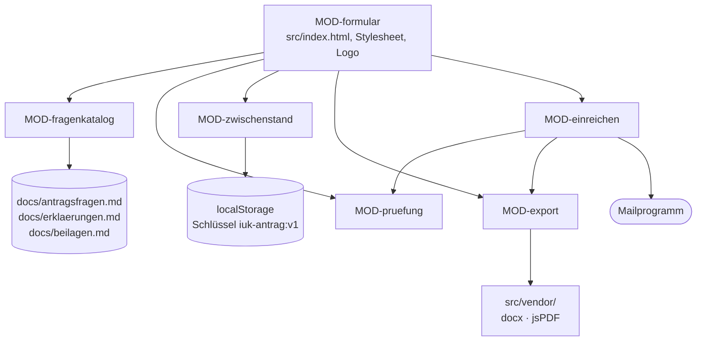

# ARC-001 Das Antragsformular als Ganzes

## Kontext

Der Antrag auf ein neues IuK-Projekt wird im Browser ausgefüllt, zwischengespeichert, als Word oder PDF exportiert und
über das Mailprogramm beim CIO-Office eingereicht (UC-001 bis UC-003). Das Produkt betreibt keinen Server, keine
Benutzerkonten und keine Datenbank (`KEIN SERVER`).

| Umfeld | Was es ist | Wie das Formular darauf trifft |
|---|---|---|
| Antragsteller/in | füllt den Antrag aus, auf dem Rechner oder dem Handy, mit Maus, Tastatur oder Screenreader | im Browser, auf der Seite des Formulars |
| Browser | führt das Formular aus und hält den Zwischenstand in `localStorage` | einzige Laufzeitumgebung; alle Programmteile kommen vom Ursprung der Seite |
| WordPress der FAU | die Seite, von der Antragstellende kommen; die Redakteurin darf weder Plugins noch Skripte einfügen | bettet die Seite des Formulars per `<iframe>` ein oder verlinkt sie |
| GitHub Pages | liefert die Dateien des Repositorys als statische Seiten aus, zunächst nur zum Testen | Ursprung der Seite: `https://monicahinrichs-mayer.github.io/Test1/` |
| Mailprogramm | das für `mailto:` eingestellte Programm auf dem Gerät | wird mit Empfänger, Betreff und Text geöffnet; nie mit einer Antwort |
| CIO-Office | empfängt den Antrag unter `cio-office@fau.de` | nur über die Mail, die die Person selbst sendet |

## Entscheidung

**Muster: eine statische Single-Page-Anwendung ohne Build-Schritt.** Das Formular ist eine HTML-Seite mit ES-Modulen,
einem Stylesheet und zwei mitgelieferten Bibliotheken. Der Browser lädt alles vom Ursprung der Seite; es gibt keinen
Server-Code, keinen Build und keine Anfrage an einen fremden Ursprung (`KEIN SERVER`).

**Der Fragenkatalog ist Daten.** Die Fragen, ihre Antwortarten und ihre Pflicht stehen einmal, in
`docs/antragsfragen.md`, ebenso die Verteilung ihrer Abschnitte auf die fünf Laschen (je Lasche eine Überschrift
`# Lasche: …`); die Erklärungen zu den Fragen einmal, in `docs/erklaerungen.md`; welche Antwort eine Beilage ankündigt,
einmal, in `docs/beilagen.md`. Die Seite liest die drei Dateien
beim Laden und baut das Formular daraus. Kein Programmteil wiederholt eine Frage (*Nichts doppelt*): eine geänderte
Fassung des Antrags ist eine geänderte Tabelle, kein geänderter Code.

### Struktur

| Modul | Ordner | Verantwortung |
|---|---|---|
| MOD-fragenkatalog | `src/fragenkatalog/` | liest die Tabellen der Fragen, Erklärungen und Beilagen und liefert Laschen, Abschnitte und Fragen |
| MOD-pruefung | `src/pruefung/` | sagt, welche Fragen gerade Pflicht sind, welche davon unbeantwortet und wie viel Prozent beantwortet |
| MOD-zwischenstand | `src/zwischenstand/` | liest, schreibt und löscht die Antworten in `localStorage` |
| MOD-export | `src/export/` | erzeugt aus Katalog und Antworten ein Word-Dokument oder ein PDF |
| MOD-einreichen | `src/einreichen/` | prüft, speichert das Word-Dokument, öffnet das Mailprogramm und nennt die Beilagen |
| MOD-formular | `src/formular/` | die Seite: zeichnet das Formular, bindet die Eingaben, trägt das Erscheinungsbild der FAU |

Die Module benutzen einander ohne Zyklus; nur MOD-formular berührt das DOM. MOD-fragenkatalog, MOD-pruefung,
MOD-zwischenstand und MOD-export sind ohne Seite testbar (*Design to test*).

### Zusammenspiel

- **Laden (UC-001 1–2).** `src/index.html` lädt MOD-formular. Es setzt den Titel des Antrags aus MOD-export als
  Hauptüberschrift, liest über MOD-fragenkatalog die beiden Tabellen, über MOD-zwischenstand die gespeicherten
  Antworten, zeichnet die Fortschrittsleiste, die Reiter der fünf Laschen und je Lasche ein Feld ihrer Abschnitte —
  jeden Abschnitt als Überschrift, jede Frage als Feld ihrer Antwortart, mit eingeklappter Erklärung (`
`),
  Pflichtkennzeichen (`*` und `aria-required`) und Antwort —, zeigt die erste Lasche und setzt den Fokus in ihr erstes
  Feld. Die übrigen Laschen sind gezeichnet, aber verborgen (`hidden`).
- **Eingabe (UC-001 3–4).** Jede Änderung eines Feldes schreibt die Antworten über MOD-zwischenstand. Eine Antwort auf
  V1, V3 oder C4 lässt MOD-formular über MOD-pruefung die Pflicht der Folgefrage neu kennzeichnen. Nach jeder Änderung
  fragt MOD-formular MOD-pruefung nach dem Fortschritt des ganzen Antrags und jeder Lasche und setzt Leiste und Häkchen.
- **Laschen (UC-001 3d).** Die Reiter folgen dem Muster *Tabs* der WAI-ARIA Authoring Practices: `role="tablist"`,
  je Reiter `role="tab"` mit `aria-selected` und `aria-controls`, je Lasche `role="tabpanel"`; Pfeiltasten, `Pos1` und
  `Ende` wechseln den Reiter. Ein Wechsel verbirgt und zeigt nur; die Felder und ihre Werte bleiben im DOM.
- **Löschen (UC-001 5a).** Nach `confirm` entfernt MOD-zwischenstand den einen Schlüssel des Formulars, und MOD-formular
  leert jedes Feld.
- **Export (UC-002).** MOD-export baut aus Katalog und Antworten das Dokument; ist laut MOD-pruefung eine Pflichtfrage
  unbeantwortet, steht unter dem Titel „Entwurf – unvollständig“; darunter das Datum der Antragstellung, der Tag des
  Exports. Der Browser speichert die Datei über einen `Blob`-Download.
- **Einreichen (UC-003).** MOD-einreichen fragt MOD-pruefung nach unbeantworteten Pflichtfragen. Sind es welche, gibt es
  sie an MOD-formular, das sie nennt, die Lasche der ersten zeigt und sie fokussiert. Sonst speichert es das
  Word-Dokument über MOD-export und
  setzt danach `location.href` auf `mailto:cio-office@fau.de` mit festem Betreff und festem Text. Es gibt MOD-formular
  die Beilagen, die die Antworten ankündigen, und MOD-formular zeigt sie mit dem Word-Dokument als Checkliste.

### Strategie

- **Ein Schlüssel im Browser.** Der Zwischenstand liegt unter genau einem Schlüssel `iuk-antrag:v1` als JSON
  `{ "<Nr>": "<Antwort>" }`. *Entwurf löschen* entfernt genau diesen Schlüssel — und keinen anderen: auf demselben
  Ursprung `monicahinrichs-mayer.github.io` liegen auch die Einstellungen des Agent-M-Dashboards.
- **Bibliotheken mitgeliefert und gepinnt.** `docx` (MIT) erzeugt das Word-Dokument, `jsPDF` (MIT) das PDF. Beide liegen
  als einzelne Dateien in `src/vendor/`, jede mit Version und SHA-256 in `src/vendor/VERSIONS.md`. Sie werden erst beim
  Klick auf einen Export geladen (`import()`), damit die Seite in unter drei Sekunden steht.
- **Erscheinungsbild.** Ein Stylesheet `src/formular/formular.css` mit FAU-Blau `#04316a` als Hauptfarbe, Systemschrift,
  Bedienelementen von mindestens 24 × 24 px und einem Layout, das unter 320 px Breite umfließt; das Logo der FAU als
  Datei in `src/formular/`, mit Textalternative.
- **Keine Antwort in einer Adresse.** Antworten gehen nur in `localStorage`, in das DOM und in den erzeugten `Blob`; die
  `mailto:`-Adresse ist eine Konstante.
- **Auslieferung.** GitHub Pages liefert das Repository ab seiner Wurzel aus dem Branch `main`; das Formular steht unter
  `/Test1/src/`, die Tabellen unter `/Test1/docs/`. Zunächst nur zum Testen.
- **Einbettung.** Die WordPress-Seite bettet `https://monicahinrichs-mayer.github.io/Test1/src/` per `<iframe>` ein; lässt
  das FAU-CMS keinen `<iframe>` zu, verlinkt sie die Seite. Das Formular funktioniert in beiden Fällen gleich.
- **Tests.** Jede Anforderung, deren Check einen Test nennt, hat ihn unter `tests/`; die Tests laufen mit Node.js und
  Playwright in GitHub Actions bei jedem Push, nicht auf dem Rechner der Product Ownerin.

## Alternativen

- **WordPress-Plugin mit Shortcode** — verworfen: auf dem FAU-CMS darf die Redakteurin kein Plugin installieren.
- **Code in einem Block „Individuelles HTML“** — verworfen: WordPress entfernt Skripte für Redakteurinnen.
- **Formular als Formular-Plugin (z. B. Gravity Forms) mit Speicherung in WordPress** — verworfen: widerspricht
  `KEIN SERVER` und dem Zwischenstand nur im Browser.
- **Fragen im Code statt als Tabelle** — verworfen: die Fragen stünden zweimal, in `docs/antragsfragen.md` und im Code.
- **PDF über den Druckdialog des Browsers** — verworfen: kein Export in einem Klick, und das Ergebnis hängt vom Browser ab.
- **Ein Build mit npm und Bundler** — verworfen: zwei Bibliotheksdateien rechtfertigen keine Build-Kette (*KISS*).

## Konsequenzen

- Eine neue Fassung des Antrags ändert `docs/antragsfragen.md` und `docs/erklaerungen.md`, aber keinen Code; ebenso eine
  andere Verteilung der Abschnitte auf Laschen.
- Die allgemeinen Angaben K1 bis K3 und das Datum C6 entfallen. Antworten darauf in einem älteren Entwurf zeigt und
  exportiert das Formular nicht mehr; *Entwurf löschen* entfernt sie mit.
- `docs/erklaerungen.md` entsteht neu: je Frage eine Erklärung für jemanden, der zum ersten Mal einen IuK-Antrag stellt;
  sie wird wie jedes Dokument geprüft.
- Das Logo der FAU muss als Datei bereitgestellt werden, aus den Vorlagen des Corporate Designs der FAU.
- **Solange GitHub Pages ausliefert, teilt das Formular seinen Ursprung mit dem Agent-M-Dashboard.** Jedes Skript der
  Seite könnte die dort gespeicherten GitHub-Schlüssel lesen. Das Formular liest nur seinen eigenen Schlüssel, und die
  Bibliotheken sind gepinnt und geprüft; für den Betrieb zieht das Formular auf einen FAU-Webspace um.
- GitHub Pages muss für Test1 eingeschaltet werden (Branch `main`, Ordner `/ (root)`).
- Ein `<iframe>` gibt dem Formular einen eigenen Ursprung; sein Zwischenstand gehört dem Ursprung der Formularseite, nicht
  dem der WordPress-Seite.
